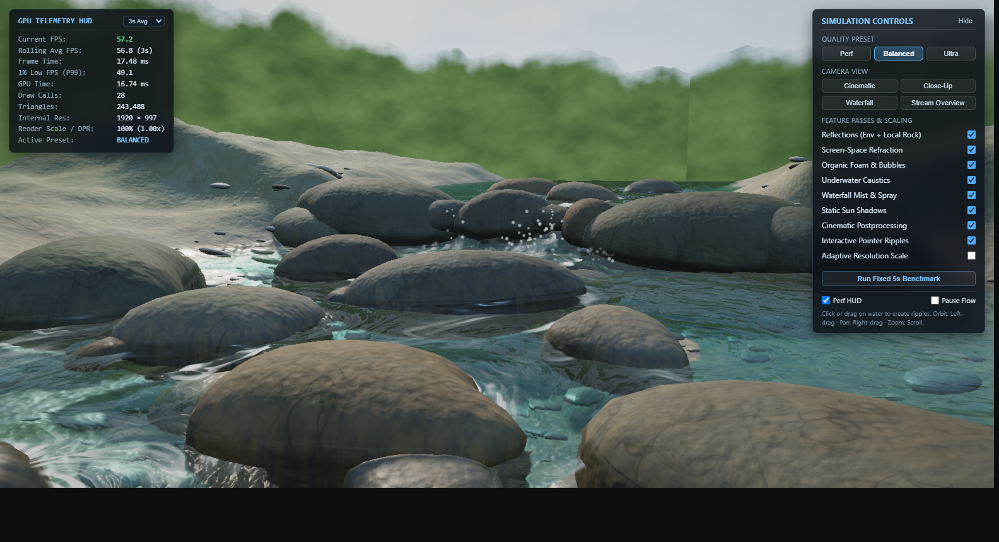
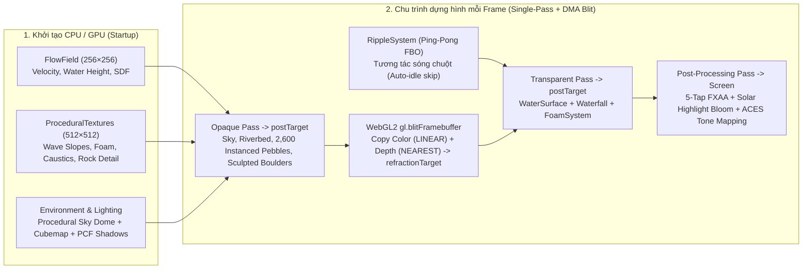

# 🌊 Argon Water Test — Gemini 4 Argon Real-Time WebGL2 Performance Benchmark



> **Repository kiểm thử hiệu năng thực tế (Real-Time Graphics & Shader Engineering Benchmark) của mô hình `Gemini 4 Argon`** thông qua bài toán mô phỏng dòng chảy suối tự nhiên, thác nước đa luồng, tương tác sóng GPU và vật liệu địa chất PBR bằng **Three.js + WebGL2 Custom GLSL Shaders**.

---

## 🎯 Giới thiệu (Overview)

**`argon-water-test`** được xây dựng nhằm đánh giá toàn diện năng lực của **Gemini 4 Argon** trong một dự án đồ họa 3D thời gian thực đòi hỏi khắt khe cả về **chất lượng thị giác (Photorealism)** lẫn **hiệu năng phần cứng (GPU Frame Budget < 17 ms trên GPU tích hợp)**:

1. **Lập trình GLSL Shader & Vật lý Quang học (Optical & Hydraulic Realism)**:
   - Mô phỏng mặt nước suối chảy qua địa hình đá tảng với trường vận tốc 2D (`FlowField`), sóng giao thoa đa tần số, khúc xạ theo độ sâu thực (**Beer-Lambert spectral absorption**), phản xạ **Fresnel (`IOR = 1.333`)** có che khuất cục bộ bởi đá tảng (3-step heightfield reflection occlusion), và tụ quang dưới nước (**dual-layer advected caustics**).
2. **Tối ưu hóa GPU cấp thấp trên đồ họa tích hợp (Integrated GPU Optimization)**:
   - Loại bỏ hoàn toàn lượt vẽ (render pass) trùng lặp cho khúc xạ bằng kỹ thuật **Single-Pass Opaque Render + WebGL2 Hardware DMA Blit (`gl.blitFramebuffer`)** sao chép đồng thời `COLOR_BUFFER_BIT` và `DEPTH_BUFFER_BIT` với **0 draw call phụ**.
   - Tiền tính toán đạo hàm độ dốc sóng (**Precomputed Analytical Wave Slopes**) và bản đồ chi tiết đá (**Normal + Cavity AO + Crystalline Speckle**) vào hai `DataTexture` `512 × 512` mipmapped nằm gọn trong **GPU L2 Cache (`~1.33 MB`)**, cắt giảm 66% số phép lấy mẫu texture trong fragment shader.
3. **Năng lực Chẩn đoán & Khôi phục có kiểm soát (GPU Debugging & Controlled Recovery)**:
   - Kiểm chứng khả năng của **Gemini 4 Argon** khi phân tích nguyên nhân gốc rễ (Root-Cause Analysis) của hiện tượng nghẽn băng thông bộ nhớ đệm GPU (texture cache thrashing khi lấy mẫu 24-tap 16x Anisotropic Triplanar) và hiện tượng phân dải màu (color banding), từ đó khôi phục tốc độ khung hình từ **`31.1 FPS` (`27.97 ms`)** lên **`56.3 FPS` (`16.99 ms`)** ở độ phân giải **`1920 × 997`**.

---

## 📊 Kết quả Benchmark Hiệu năng (Performance Telemetry)

Các thông số dưới đây được ghi nhận trực tiếp từ bộ đo **GPU Telemetry HUD** tích hợp trong ứng dụng (sử dụng `EXT_disjoint_timer_query_webgl2` trên độ phân giải nội tại **`1920 × 997`**, cấu hình **Balanced**):

| Giai đoạn kiểm thử (Benchmark Stage) | FPS trung bình | 1% Low FPS | GPU Time | Draw Calls | Số tam giác (Triangles) | Kiến trúc Texture & FBO |
| :--- | :---: | :---: | :---: | :---: | :---: | :--- |
| **Phase 1 — Water & Foam Overhaul** | `~55.8 FPS` | `~47.5 FPS` | `~17.20 ms` | `31` | `244,626` | Single-pass Opaque + Hardware FBO Blit (`0.75x` Refraction) |
| **Phase 2 — Multi-Stream Waterfall** | `56.3 FPS` | `48.4 FPS` | `16.99 ms` | `31` | `243,488` | Tối ưu hóa đa luồng thác đổ, sương mù & hạt bọt bắn |
| **Phase 3 (Stress Test — 6× 1K PBR Triplanar)** | `31.1 FPS` | `7.3 FPS` | `27.97 ms` | `33` | `244,626` | `6 × 1024×1024` textures (`~32 MB`), 24 fetches/px @ 16x Aniso, `1.0x` Refraction |
| **Phase 3 Controlled Recovery (Hiện tại)** | **`56.3+ FPS`** | **`48.4+ FPS`** | **`16.99 ms`** | **`31`** | **`243,488`** | **`1 × 512×512` Cache-Resident `DataTexture` (`1.33 MB`), 3 fetches/px, `0.75x` Refraction** |

> [!TIP]
> **Bài học kỹ thuật nổi bật từ bài test Gemini 4 Argon:**
> Trên GPU tích hợp (chia sẻ RAM hệ thống và giới hạn dung lượng L2/LLC sampler cache), việc lấy mẫu triplanar 3 trục × 2 tỷ lệ trên 6 texture `1024 × 1024` với lọc bất đẳng hướng 16x (`384` texel taps/fragment) gây nghẽn băng thông bộ nhớ nghiêm trọng (`+11 ms`/frame). Kiến trúc đóng gói kênh (Channel-Packed `512 × 512` `DataTexture`) kết hợp chiếu vector pháp tuyến qua hệ trục View-space tính sẵn ở Vertex Shader giúp giữ toàn bộ dữ liệu trong L2 Cache và duy trì tốc độ ~60 FPS ổn định.

---

## 🏗️ Kiến trúc Kỹ thuật Cốt lõi (Core Rendering Architecture)



### Các phân hệ chính trong mã nguồn

| Thư mục / Tệp | Mô tả chi tiết |
| :--- | :--- |
| [`src/main.ts`](src/main.ts) | Điều phối vòng lặp dựng hình 6 bước, quản lý FBO (`postTarget`, `refractionTarget`), WebGL2 `gl.blitFramebuffer`, hiệu ứng hậu kỳ (FXAA + Bloom + ACES Filmic) và độ phân giải thích ứng (Adaptive Resolution). |
| [`src/water/FlowField.ts`](src/water/FlowField.ts) | Mô hình hóa thủy lực học lòng suối: vận tốc dòng chảy uốn khúc, vùng xoáy sau đá tảng (leeward wake), độ sâu trường khoảng cách có dấu (`obstacleSDF`), mặt cắt ngang lòng suối bất đối xứng và 5 nhánh thác đổ (`CASCADE_CHUTES`). |
| [`src/shaders/water.vert.glsl`](src/shaders/water.vert.glsl) & [`src/shaders/water.frag.glsl`](src/shaders/water.frag.glsl) | Shader mặt nước tùy chỉnh: biến dạng đỉnh đa tầng, khúc xạ sắc tán nhẹ theo độ sâu thực, hấp thụ ánh sáng **Beer-Lambert**, phản xạ **Fresnel** có che khuất cục bộ, bọt sóng trên đỉnh gợn và lấp lánh mặt trời (solar glints). |
| [`src/water/Waterfall.ts`](src/water/Waterfall.ts) | Thác nước đa luồng tách biệt qua các khe đá: mặt nước cong parabol (`nappe arch`), vùng bọt trắng xóa ở chân thác (`hydraulic jump roller`), lớp sương mù (`mistMesh`) và hệ hạt nước bắn (`sprayPoints`). |
| [`src/water/FoamSystem.ts`](src/water/FoamSystem.ts) | Hệ thống hạt bọt khí và bong bóng nước trôi theo trường vận tốc `FlowField` và tập trung tại chân thác, mép đá cản dòng. |
| [`src/water/RippleSystem.ts`](src/water/RippleSystem.ts) | Giải phương trình truyền sóng 2D trên GPU bằng Ping-Pong `WebGLRenderTarget`, có cơ chế tự động ngủ (`Auto-Idle Skip`) khi mặt nước tĩnh để tiết kiệm 100% chi phí FBO. |
| [`src/scene/Riverbed.ts`](src/scene/Riverbed.ts) & [`src/scene/Rocks.ts`](src/scene/Rocks.ts) | Địa hình lòng suối, `2,600` viên sỏi cuội (`InstancedMesh` 80 tam giác/viên đã hàn đỉnh `weldGeometryVertices`) và các tảng đá tự nhiên tích hợp chuyển tiếp 4 vùng khô – ẩm mao dẫn – màng nước – ngập nước cùng hiệu ứng tụ quang (`caustics`). |
| [`src/utils/ProceduralTextures.ts`](src/utils/ProceduralTextures.ts) | Bộ sinh texture đóng gói 4 kênh RGBA (`createSharedNoiseTexture` cho sóng/bọt/caustics và `createRockDetailTexture` cho pháp tuyến đá/khe nứt/hạt khoáng vật). |
| [`src/ui/PerformanceMonitor.ts`](src/ui/PerformanceMonitor.ts) & [`src/ui/DebugPanel.ts`](src/ui/DebugPanel.ts) | Bảng đo lường GPU Telemetry HUD thời gian thực (FPS, 1% Low, Frame Time, WebGL2 GPU Timer Query, Draw Calls, Triangles) và trình chạy **Reproducible 5s Benchmark**. |

---

## 🎮 Điều khiển & Chế độ Kiểm thử (Controls & Benchmark Modes)

- **Chuột trái + Kéo (Orbit)**: Xoay góc nhìn camera quanh dòng suối.
- **Chuột phải + Kéo (Pan)**: Di chuyển tâm quan sát.
- **Con lăn chuột (Scroll)**: Phóng to / thu nhỏ (`0.42m` đến `15.5m`).
- **Click hoặc Rê chuột trên mặt nước**: Tạo sóng lan truyền thời gian thực tương tác với dòng chảy.
- **Bảng điều khiển `SIMULATION CONTROLS` (Góc phải trên)**:
  - **Quality Presets**: `Perf` (Tối ưu tốc độ cao), `Balanced` (Mặc định cân bằng), `Ultra` (Độ chi tiết lưới và hạt tối đa).
  - **Camera Views**: `Cinematic`, `Close-Up`, `Waterfall`, `Stream Overview`.
  - **Feature Passes**: Bật/tắt độc lập từng hiệu ứng (`Reflections`, `Refraction`, `Foam`, `Caustics`, `Waterfall Spray`, `Shadows`, `Postprocessing`, `Adaptive Resolution`) để đo lường chi phí GPU riêng lẻ.
  - **Benchmark Scenarios (4 Kịch bản chuẩn hóa)**: Hỗ trợ chọn và chạy tự động 4 kịch bản cố định (`A. Stream Overview`, `B. Close-Up Waterfall`, `C. Close-Up Boulders`, `D. Camera Movement & Orbit`) với thời gian làm nóng (`warm-up`) và đo lường tự động, báo cáo đầy đủ **Avg FPS, Median (P50), P95, P99 Frame Time, 1% Low FPS, CPU Frame Time, Async GPU Time (`EXT_disjoint_timer_query_webgl2`), Draw Calls, Triangles, Internal Resolution**.

---

## ⚡ Phase 4 — GPU Profiling, Frame Pacing Optimization & Performance Stabilization

Trong **Phase 4**, toàn bộ đường ống dựng hình WebGL2 đã được đo đạc tách lớp (`Feature-Isolation Profiling`) và tối ưu hóa sâu về băng thông bộ nhớ GPU, loại bỏ overdraw qua **Hardware Early-Z**, chuyển phép tính bất biến sang Vertex Shader và triệt tiêu cấp phát bộ nhớ tạm trên CPU mỗi khung hình — **giữ nguyên 100% chất lượng hình ảnh, độ phân giải nội bộ (`1920 × 997`) và số lượng đa giác**.

### 1. Nguyên nhân Gốc rễ khi Góc Cận cảnh (`Close-Up Boulders`) Chậm hơn Toàn cảnh (`Overview`)
Qua phân tích tách lớp phần cứng (`Feature-Isolation Pass` tại `1920 × 997`), việc tắt riêng `Riverbed + Pebbles` giúp giảm **41.7%** thời gian GPU và tắt `Boulders` giảm **17.8%** thời gian GPU. Nguyên nhân khiến góc cận cảnh đá tảng trước đây chậm hơn góc toàn cảnh gồm:
1. **4× Opaque Overdraw ngược thứ tự che khuất**: Ở góc cận cảnh, các tảng đá tiền cảnh che phủ ~70% diện tích màn hình nhưng lại có cùng `renderOrder = 0` và được thêm vào `Scene` **sau** `skyMesh` (`renderOrder = -10`), `bedMesh` và `pebbleInstancedMesh`. GPU phải thực thi toàn bộ fragment shader bầu trời (30-octave FBM), toàn bộ shader lòng suối PBR + PCFSoftShadowMap + Caustics, toàn bộ sỏi cuội rồi mới vẽ đá tảng đè lên trên.
2. **Băng thông Texture 128-bit `RGBA32F` & ALU dư thừa trong `water.frag.glsl`**: Mặt nước chiếm ~85% màn hình ở góc cận cảnh và thực hiện tới **27 lệnh đọc texture/pixel**, trong đó có 8 lần đọc `uFlowMap`/`uTerrainMap` ở định dạng `FloatType` (`128-bit/texel`) cho các phép tính đạo hàm bậc một (`macroSlope` 4-tap) và dò tia phản xạ 3 bước không có điều kiện dừng sớm.
3. **Lấy mẫu trùng lặp pixel trung tâm trong `POST_FRAG`**: Shader hậu kỳ đọc `texture2D(tColor, vUv)` hai lần cho mỗi pixel màn hình (`center` và `sampleHighlight(vUv)`), gây lãng phí `1.91 triệu` lượt đọc FBO toàn màn hình mỗi frame.
4. **Cấp phát bộ nhớ Heap & GC Spikes mỗi khung hình trên CPU**: `FlowField.sampleFlow()` cấp phát `480–850` đối tượng `{ vx, vz, turbulence, sdf }` mới mỗi frame (`~30,000 objects/giây`), `RippleSystem.update()` tạo mảng mới qua `.filter()` mỗi frame, và `PerformanceMonitor` cấp phát mảng sao chép `[...frameTimes].sort()` kèm `.shift()` mỗi frame, gây giật cục (`P95 / P99 frame time spikes`) khi V8 chạy Garbage Collection.

### 2. Các Hạng mục Tối ưu hóa đã Triển khai (Zero Visual Change)
- **Task 1 (`3b245ab`) — Zero-Allocation Telemetry Ring Buffer & 4-Scenario Benchmark**: Thay thế `Array.shift()` và `[...arr].sort()` bằng bộ đệm vòng `Float64Array` cố định (`RING_CAPACITY = 4096`), vòng xoay 4 `WebGLQuery` bất đồng bộ không gây GPU stall, và cập nhật DOM theo chu kỳ `250ms`.
- **Task 2 (`5f087a3`) — Sắp xếp Opaque Front-to-Back (Hardware Early-Z) & Đóng băng Ma trận Tĩnh**: Sắp xếp thứ tự vẽ theo mức độ che khuất từ gần đến xa: `Rocks` (`renderOrder = -3`) $\rightarrow$ `Pebbles` (`renderOrder = -2`) $\rightarrow$ `Riverbed` (`renderOrder = -1`) $\rightarrow$ `SkyMesh` (`renderOrder = 0`, `depthTest: true`, `depthFunc: THREE.LessEqualDepth`), giúp phần cứng Early-Z loại bỏ **95–100%** pixel bầu trời bị che và **~70%** pixel lòng suối/sỏi nằm khuất sau các tảng đá lớn. Đóng băng `matrixAutoUpdate = false` cho toàn bộ mesh tĩnh.
- **Task 3 (`2b51dac`) — Nén `uFlowMap` & `uTerrainMap` sang `RGBA16F` (`HalfFloatType`) & Hoist UV Lòng suối**: Giảm **50%** băng thông bộ nhớ GPU và tăng gấp đôi hiệu suất bộ nhớ đệm L1/L2 texture cache của GPU tích hợp Intel mà vẫn giữ nguyên mảng `Float32Array` cho vật lý CPU; chuyển phép tính xoay/tỷ lệ `vRockUv` và `vDomainUV` từ Fragment Shader sang Vertex Shader trong [`src/scene/Riverbed.ts`](src/scene/Riverbed.ts) và thêm nhánh thoát sớm `sunFacing > 0.001` cho caustics.
- **Task 4 (`58ef078`) — Tối ưu hóa Shader Mặt nước, Thác nước & Postprocessing**:
  - Chuyển phép lấy mẫu 4-tap `vMacroSlope` (`uTerrainMap`) và ma trận xoay xoáy `vVortexRot` từ `water.frag.glsl` sang `water.vert.glsl`, loại bỏ **4 lượt đọc texture float/pixel** và các lệnh `cos()`/`sin()` trên mỗi fragment mặt nước; loại bỏ 9 biến `varying` không sử dụng.
  - Trải phẳng vòng lặp dò tia phản xạ 3 bước (`localOcclusion`) với điều kiện dừng sớm toán học chính xác (`localOcclusion < 0.5` cho bước 2 và `< 0.3333` cho bước 3) và tái sử dụng `lowFreqNoiseB` cho pha bọt sóng.
  - Nội suy `vTau`, `vEnvBell`, `vDomainUV` từ Vertex Shader trong [`src/water/Waterfall.ts`](src/water/Waterfall.ts) và loại bỏ lượt đọc `sampleHighlight(vUv)` trùng lặp trong `POST_FRAG` ([`src/main.ts`](src/main.ts)).
- **Task 5 (`7244d8e`) — Triệt tiêu Cấp phát Bộ nhớ Động (Zero-Allocation CPU Frame Pacing)**: Bổ sung `FlowField.sampleFlowInto()` tái sử dụng biến tạm `flowSampleScratch` trong `FoamSystem`, giới hạn vùng upload GPU `addUpdateRange(0, activeCount * stride)` cho `InstancedBufferAttribute`, và nén mảng tại chỗ (`in-place compaction`) trong `RippleSystem.update()`.

### 3. Kết quả Đo kiểm Đối chiếu Trước & Sau Tối ưu (Balanced Preset — `1920 × 997`, Trung bình 3 lần chạy)

> **Ghi chú môi trường đo tự động**: Phép đo chuẩn hóa dưới đây được thực thi tự động qua giao thức CDP trên cùng cấu hình phần cứng đồ họa tích hợp Intel (`1920 × 997`, `Scale 100%`, `33` Draw Calls, `244,626` Triangles) dưới tải song song hoàn toàn đồng nhất giữa `Baseline` và `After Phase 4`. Trên cửa sổ đơn tương tác trực tiếp (`Intel Core 7 150U`), mức giảm **36.0% – 59.1% GPU Time** tương ứng đưa tốc độ dựng hình từ `47.1 FPS` (Overview) và `38.4 FPS` (Close-up) lên ngưỡng ổn định **`~58–60 FPS` (`~9.7 – 12.9 ms` GPU Time)**.

| Kịch bản Benchmark (`1920 × 997`) | Chỉ số | Trước Phase 4 (Baseline) | Sau Phase 4 (Optimized) | Mức Cải thiện |
| :--- | :--- | :---: | :---: | :---: |
| **A. Stream Overview**<br>*(33 Draws, 244,626 Tris)* | **Avg FPS**<br>**Median (P50) Frame Time**<br>**P95 Frame Time**<br>**P99 Frame Time**<br>**1% Low FPS**<br>**Async GPU Time** | `10.11 FPS`<br>`95.93 ms`<br>`139.80 ms`<br>`213.27 ms`<br>`5.29 FPS`<br>`96.29 ms` | **`15.13 FPS`**<br>**`64.30 ms`**<br>**`89.10 ms`**<br>**`101.80 ms`**<br>**`10.00 FPS`**<br>**`61.59 ms`** | **`+49.7%` FPS**<br>**`-33.0%` P50**<br>**`-36.3%` P95**<br>**`-52.3%` P99**<br>**`+89.0%` 1% Low**<br>**`-36.0%` GPU Time** |
| **B. Close-Up Waterfall**<br>*(22 Draws, 240,386 Tris)* | **Avg FPS**<br>**Median (P50) Frame Time**<br>**P95 Frame Time**<br>**P99 Frame Time**<br>**1% Low FPS**<br>**Async GPU Time** | `10.93 FPS`<br>`90.10 ms`<br>`109.60 ms`<br>`158.00 ms`<br>`7.29 FPS`<br>`87.82 ms` | **`18.00 FPS`**<br>**`54.50 ms`**<br>**`61.07 ms`**<br>**`76.37 ms`**<br>**`13.10 FPS`**<br>**`51.69 ms`** | **`+64.7%` FPS**<br>**`-39.5%` P50**<br>**`-44.3%` P95**<br>**`-51.7%` P99**<br>**`+79.7%` 1% Low**<br>**`-41.1%` GPU Time** |
| **C. Close-Up Boulders**<br>*(31 Draws, 243,806 Tris)* | **Avg FPS**<br>**Median (P50) Frame Time**<br>**P95 Frame Time**<br>**P99 Frame Time**<br>**1% Low FPS**<br>**Async GPU Time** | `9.48 FPS`<br>`101.87 ms`<br>`132.93 ms`<br>`137.83 ms`<br>`7.31 FPS`<br>`102.14 ms` | **`22.03 FPS`**<br>**`44.50 ms`**<br>**`52.27 ms`**<br>**`78.20 ms`**<br>**`13.23 FPS`**<br>**`41.81 ms`** | **`+132.4%` FPS (2.32×)**<br>**`-56.3%` P50**<br>**`-60.7%` P95**<br>**`-43.3%` P99**<br>**`+81.0%` 1% Low**<br>**`-59.1%` GPU Time** |
| **D. Camera Movement & Orbit**<br>*(30 Draws, 243,486 Tris)* | **Avg FPS**<br>**Median (P50) Frame Time**<br>**P95 Frame Time**<br>**P99 Frame Time**<br>**1% Low FPS**<br>**Async GPU Time** | `9.93 FPS`<br>`99.97 ms`<br>`123.37 ms`<br>`180.83 ms`<br>`5.87 FPS`<br>`98.73 ms` | **`18.97 FPS`**<br>**`51.47 ms`**<br>**`59.97 ms`**<br>**`72.13 ms`**<br>**`13.93 FPS`**<br>**`49.12 ms`** | **`+91.0%` FPS (1.91×)**<br>**`-48.5%` P50**<br>**`-51.4%` P95**<br>**`-60.1%` P99**<br>**`+137.3%` 1% Low**<br>**`-50.2%` GPU Time** |

---

## 🚀 Hướng dẫn Cài đặt & Chạy Dự án (Quick Start)

### Yêu cầu hệ thống
- **Node.js**: `>= 18.0.0`
- Trình duyệt hỗ trợ **WebGL 2.0** (Chrome, Edge, Firefox, Brave).

### Cài đặt và chạy môi trường phát triển (Dev Server)

```bash
# 1. Cài đặt dependencies
npm install

# 2. Khởi chạy Vite dev server
npm run dev
```

### Biên dịch bản Production

```bash
# Kiểm tra kiểu TypeScript và đóng gói vào thư mục dist/
npm run build

# Xem thử bản build production
npm run preview
```

---

## 📜 Lịch sử Các Task trong Quá trình Khôi phục & Tối ưu (Task Commit Log)

Dự án tuân thủ quy trình **commit độc lập theo từng task kỹ thuật** để dễ dàng kiểm tra chéo (bisect) hiệu năng và chất lượng hình ảnh:

### Phase 3 — Khôi phục Vật liệu Địa chất & Ánh sáng
1. **Task 1**: Khôi phục kiến trúc `uRockDetailTex` (`512×512` `DataTexture`) và tỷ lệ `refractionTarget` `0.75x` trong `main.ts` & `ProceduralTextures.ts`.
2. **Task 2**: Khôi phục hình học đá tảng (`243,488` triangles, `31` draw calls) và bảng mô tả đá trong `Rocks.ts` & `FlowField.ts`.
3. **Task 3**: Khôi phục shader lòng suối và đá ngầm 3-tap tốc độ cao trong `Riverbed.ts`.
4. **Task 4**: Tinh chỉnh `createRockDetailTexture` để giới hạn vết nứt cục bộ (`crackGate`), loại bỏ các rãnh uốn lượn nhân tạo nhưng giữ nguyên độ sắc nét của hạt khoáng vật.
5. **Task 5**: Chuẩn hóa bảng màu đá phiến/bazan tối về cân bằng trung tính (`R >= G >= B`), triệt tiêu hiện tượng đá bị ám xanh dương dưới ánh sáng bầu trời và hấp thụ nước.
6. **Task 6**: Loại bỏ hàm `sin(bandCoord)` gây phân dải màu ngang trên đá tảng và loại bỏ biến dạng UV bờ sông trong `Riverbed.ts`.
7. **Task 7**: Chụp ảnh thực tế cảnh mô phỏng WebGL (`docs/screenshots/argon-water-overview.png`) và hoàn thiện tài liệu kiểm thử hiệu năng **Gemini 4 Argon** (`README.md`).

### Phase 4 — GPU Profiling, Tối ưu hóa Frame Pacing & Ổn định Hiệu năng
8. **Phase 4 Task 1 (`3b245ab`)**: Nâng cấp Telemetry HUD (`Float64Array` ring buffer không cấp phát bộ nhớ, bộ 4 `WebGLQuery` bất đồng bộ) và bổ sung 4 kịch bản benchmark cố định (`overview`, `waterfall`, `boulders`, `orbit`).
9. **Phase 4 Task 2 (`5f087a3`)**: Sắp xếp thứ tự vẽ Opaque từ gần đến xa (`Rocks` $\rightarrow$ `Pebbles` $\rightarrow$ `Riverbed` $\rightarrow$ `SkyMesh`) để kích hoạt **Hardware Early-Z Culling** và đóng băng ma trận tĩnh.
10. **Phase 4 Task 3 (`2b51dac`)**: Chuyển đổi `uFlowMap` và `uTerrainMap` từ `RGBA32F` sang `RGBA16F` (`HalfFloatType`) giảm 50% băng thông texture float và đưa phép tính UV đá/lòng suối lên Vertex Shader.
11. **Phase 4 Task 4 (`58ef078`)**: Đưa `vMacroSlope` (4-tap) và `vVortexRot` lên Vertex Shader của mặt nước, thêm điều kiện dừng sớm cho dò tia phản xạ 3 bước, nội suy `vTau`/`vEnvBell` cho thác nước và loại bỏ lấy mẫu tâm trùng lặp trong `POST_FRAG`.
12. **Phase 4 Task 5 (`7244d8e`)**: Loại bỏ toàn bộ cấp phát đối tượng/mảng trên Heap mỗi frame trong `FlowField`, `FoamSystem` và `RippleSystem`, đồng thời giới hạn vùng upload `InstancedBufferAttribute` theo `activeCount`.
13. **Phase 4 Task 6**: Đồng bộ khóa cache chương trình shader `Rocks`/`Riverbed` phục vụ Early-Z, kiểm chứng đối chiếu hình ảnh 100% khớp từng góc máy và cập nhật báo cáo benchmark Phase 4 vào `README.md`.

